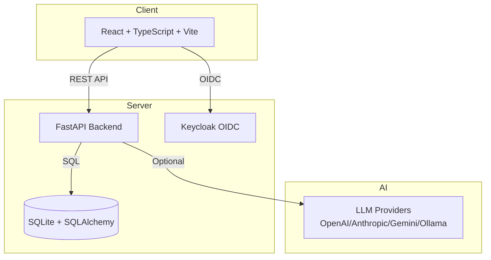

# Signal Forge — Alan Vo | AI & Machine Learning

> Work in progress. This checkpoint may be incomplete or fail tests. See PLAN.md and STATUS.md before use.


Signal Forge is an AI/ML-powered signal processing platform for developers and researchers. It provides a complete workflow for generating, analyzing, transforming, and exporting synthetic signals with optional AI-powered explanations.

## Problem

Signal processing workflows often require switching between multiple tools for generation, visualization, filtering, and analysis. Signal Forge unifies these into a single platform with a reproducible, deterministic core engine and optional AI-assisted interpretation.

## AI/ML Approach

- **Deterministic core**: All signal generation, FFT, filtering, and convolution operations run offline with NumPy/SciPy-compatible algorithms — no LLM required.
- **Advisory LLM layer**: Optional explanations for signal characteristics, filter selection guidance, and anomaly detection grounded in actual computed data.
- **Reproducible baselines**: Every operation produces deterministic output given the same inputs, enabling regression testing and validation.

## Intended User

ML engineers, DSP researchers, and developers working with time-series data who need a unified environment for signal experimentation with audit trails and export capabilities.

## Workflows

1. **Generate & Visualize** — Create sine, square, sawtooth, or noise signals with configurable parameters; view time-domain and frequency-domain plots.
2. **Filter & Compare** — Apply low-pass, high-pass, band-pass, or notch filters; compare original vs. filtered signals with overlay visualization.
3. **Export & Document** — Export signal data as CSV/JSON with metadata; generate AI-assisted analysis reports (advisory, opt-in).

## Quick Start

### Prerequisites

- Docker and Docker Compose
- Python 3.12+ (for local development)
- Node 24+ (for local frontend development)

### Using Docker Compose (Recommended)

```bash
# Copy environment template
cp .env.example .env

# Start all services (backend, frontend, Keycloak)
docker compose up -d

# Access the application
# Frontend: http://localhost:5173
# Backend API: http://localhost:8000
# Keycloak Admin: http://localhost:8080 (admin/admin)
```

### Local Development

**Backend:**
```bash
python3 -m venv .venv
source .venv/bin/activate
pip install -r backend/requirements.txt
PYTHONPATH=backend python -m uvicorn app.main:app --reload --port 8000
```

**Frontend:**
```bash
cd frontend
npm install
npm run dev
```

## Testing

### Backend Tests
```bash
PYTHONPATH=backend .venv/bin/python -m pytest backend/tests -v
```

### Frontend Tests
```bash
cd frontend
npm test
```

### Build Frontend
```bash
cd frontend
npm run build
```

## Architecture



## API Reference

### Health
- `GET /api/v1/health` — Service health check
- `GET /api/v1/health/db` — Database connectivity check

### Signals (Planned)
- `POST /api/v1/signals` — Generate a new signal
- `GET /api/v1/signals` — List signals with pagination
- `GET /api/v1/signals/{id}` — Get signal details
- `POST /api/v1/signals/{id}/process` — Apply signal processing operation
- `GET /api/v1/signals/{id}/export` — Export signal data

## Security

- **Authentication**: OIDC authorization code flow with PKCE via Keycloak
- **Authorization**: Role-based access (viewer, operator, admin)
- **Session Management**: HttpOnly SameSite cookies with CSRF protection
- **Transport**: TLS required in production (reverse proxy)
- **Secrets**: No hardcoded secrets; all via environment variables

### Limitations

- Demo mode binds to localhost only; refuses to start in production without valid OIDC config
- LLM API keys stored server-side only; never exposed to frontend
- SQLite for development; PostgreSQL recommended for production
- No audit log encryption at rest (planned)

## Provider Configuration

| Provider | Environment Variables | Notes |
|----------|----------------------|-------|
| OpenAI-compatible | `LLM_PROVIDER=openai-compatible`, `LLM_MODEL`, `LLM_BASE_URL`, `LLM_API_KEY` | Includes LiteLLM, OpenRouter, Ollama |
| Anthropic | `LLM_PROVIDER=anthropic`, `LLM_MODEL`, `LLM_API_KEY` | Uses Anthropic Messages API |
| Gemini | `LLM_PROVIDER=gemini`, `LLM_MODEL`, `LLM_API_KEY` | Uses Google Generative Language API |
| Ollama | `LLM_PROVIDER=ollama`, `LLM_MODEL`, `LLM_BASE_URL` | Local models, no API key needed |

## SSO/SAML Setup

Keycloak supports SAML 2.0 identity providers through Identity Brokering:

1. In Keycloak Admin Console, go to **Identity Providers** → **SAML v2.0**
2. Configure your IdP metadata (entity ID, SSO URL, certificates)
3. Map SAML attributes to Keycloak user attributes
4. Add the identity provider to the Signal Forge realm

## Backup & Restore

```bash
# Backup database
docker compose exec backend cp /app/backend/signal_forge.db ./backup/signal_forge_$(date +%Y%m%d).db

# Restore database
docker compose exec backend cp ./backup/signal_forge_20240101.db /app/backend/signal_forge.db
```

## License

MIT License — Copyright (c) 2024 Alan Vo <alanvo@gmail.com>